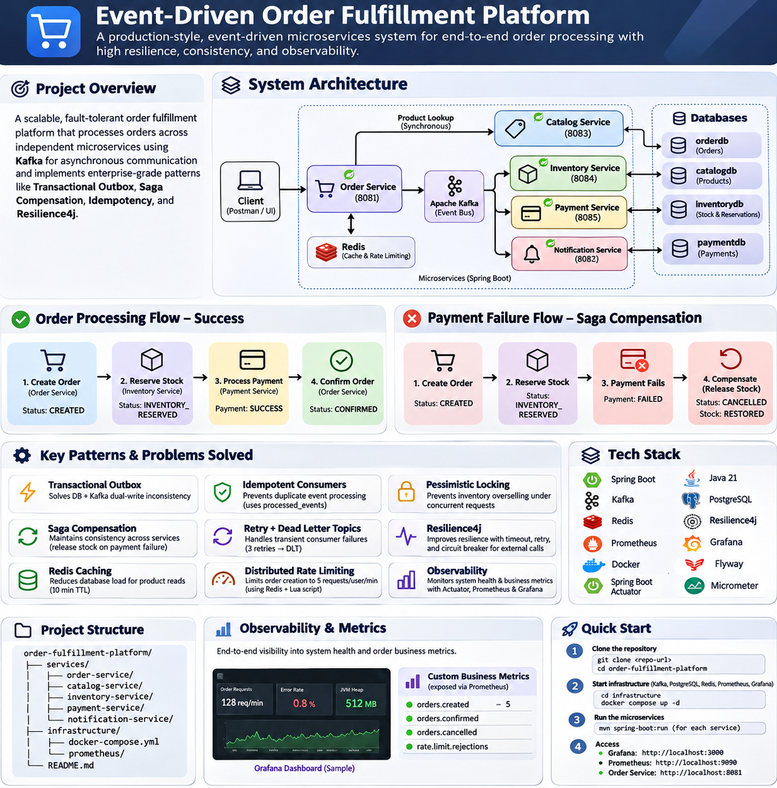

# Event-Driven Order Fulfillment Platform

A production-style **event-driven order fulfillment backend** built with **Java 21, Spring Boot, Apache Kafka, PostgreSQL, Redis, Resilience4j, Prometheus, and Grafana**.

The platform models a real-world order lifecycle across independent microservices and demonstrates practical distributed-systems patterns for **reliability, consistency, concurrency control, caching, resilience, and observability**.

---

## Architecture



The platform contains five Spring Boot microservices:

| Service | Port | Responsibility |
|---|---:|---|
| Order Service | 8081 | Entry point for order creation, order lifecycle, rate limiting, and final status updates |
| Notification Service | 8082 | Consumes `order.created` events for notification workflows |
| Catalog Service | 8083 | Product information, pricing, Redis caching, and product updates |
| Inventory Service | 8084 | Stock reservation, concurrency control, idempotency, and Saga compensation |
| Payment Service | 8085 | Payment processing and publishing payment outcomes |

Infrastructure:

| Component | Port | Purpose |
|---|---:|---|
| PostgreSQL | 5432 | Persistent relational storage |
| Kafka | 9092 | Asynchronous event communication |
| Redis | 6379 | Product cache and distributed rate limiting |
| Prometheus | 9090 | Metrics collection |
| Grafana | 3000 | Metrics visualization |

---

## End-to-End Order Flow

### Successful order

1. Client sends `POST /api/orders` to Order Service.
2. Order Service applies the Redis-based per-user rate limit.
3. Order Service synchronously calls Catalog Service to validate the product and fetch the current price.
4. Catalog Service checks Redis first; on a cache miss it reads PostgreSQL and caches the result.
5. Order Service saves the order with status `CREATED`.
6. Order Service writes an `order.created` event to its outbox in the same database transaction.
7. The Order Outbox Publisher publishes `order.created` to Kafka.
8. Inventory Service consumes the event, locks inventory rows, validates stock, and reserves inventory transactionally.
9. Inventory Service writes `inventory.reserved` to its outbox.
10. Payment Service consumes `inventory.reserved` and processes payment.
11. Payment Service writes `payment.completed` to its outbox.
12. Order Service consumes `payment.completed` and changes the order status to `CONFIRMED`.

Final lifecycle:

```text
CREATED
   ↓
INVENTORY_RESERVED
   ↓
CONFIRMED
```

### Payment failure and Saga compensation

When payment fails:

1. Payment Service publishes `payment.failed`.
2. Order Service consumes the event and changes the order to `CANCELLED`.
3. Inventory Service also consumes `payment.failed`.
4. Inventory Service finds the stored reservation for the order.
5. Reserved stock is returned to `available_quantity`.
6. The reservation status changes from `RESERVED` to `RELEASED`.

Final state:

```text
Order       → CANCELLED
Reservation → RELEASED
Stock       → RESTORED
```

This is the compensation step of the Saga and prevents stock from remaining reserved after a failed payment.

---

## Key Engineering Problems Solved

### 1. Database + Kafka dual-write inconsistency → Transactional Outbox

A direct implementation such as:

```text
Save order to DB
Publish Kafka event
```

can leave the system inconsistent if the database succeeds but Kafka publishing fails.

The platform uses the **Transactional Outbox Pattern** in:

- Order Service
- Inventory Service
- Payment Service

Business data and the corresponding outbox event are written in the **same PostgreSQL transaction**.

```text
Business DB change
      +
Outbox event
      ↓
single transaction
      ↓
COMMIT
      ↓
background outbox publisher
      ↓
Kafka
```

Outbox events move through:

```text
PENDING → PUBLISHED
```

The publisher waits for Kafka acknowledgement before marking the event as published.

---

### 2. Duplicate Kafka deliveries → Idempotent consumers

Kafka consumers can receive the same event more than once.

Inventory Service uses:

```text
processed_events
```

with `event_id` as a primary key.

Before applying a stock mutation:

```text
Already processed?
   ├─ Yes → ignore duplicate
   └─ No  → process and store event_id
```

This prevents duplicate stock reservations and duplicate compensation.

---

### 3. Inventory overselling → Pessimistic locking

Two concurrent orders should never reserve the same last unit.

Inventory Service uses JPA pessimistic write locking:

```java
@Lock(LockModeType.PESSIMISTIC_WRITE)
```

The inventory row is locked inside the reservation transaction so only one transaction can modify the stock at a time.

For multi-item orders, product IDs are sorted before locking to reduce deadlock risk.

---

### 4. Partial multi-item reservation → Database transactions

A multi-item order must either reserve **all items** or **none**.

Inventory reservation runs inside `@Transactional`.

If one item fails because stock is unavailable, the entire reservation transaction rolls back.

---

### 5. Distributed partial failure → Saga compensation

Order, Inventory, and Payment use separate databases, so one ACID transaction cannot cover the complete workflow.

The project uses Saga-style compensation:

```text
Inventory reserved
      ↓
Payment failed
      ↓
Order cancelled
      +
Inventory released
```

Inventory reservations are persisted in:

```text
inventory_reservations
```

with statuses:

```text
RESERVED
RELEASED
```

This allows the system to reverse the stock reservation safely when payment fails.

---

### 6. Temporary Kafka consumer failure → Retry + Dead Letter Topics

A valid Kafka record may fail because of:

- temporary database errors
- infrastructure failures
- runtime exceptions
- transient dependencies

Consumers use:

- `DefaultErrorHandler`
- `FixedBackOff`
- `DeadLetterPublishingRecoverer`

Current retry behavior:

```text
Initial attempt
    ↓ failure
wait 1 second
Retry 1
    ↓ failure
wait 1 second
Retry 2
    ↓ failure
Dead Letter Topic
```

Total processing attempts: **3**

Configured DLT topics:

```text
order.created.DLT
inventory.reserved.DLT
inventory.failed.DLT
payment.completed.DLT
payment.failed.DLT
```

Business failures such as insufficient inventory are **not** treated as technical failures. They follow the normal `inventory.failed` business flow instead of being blindly retried.

---

### 7. Malformed Kafka messages → ErrorHandlingDeserializer

Kafka consumers use Spring Kafka `ErrorHandlingDeserializer` with Jackson deserialization.

This prevents malformed records from repeatedly crashing normal event processing and allows valid records to continue flowing.

---

### 8. Slow or unavailable Catalog Service → Timeout + Retry + Circuit Breaker

Order Service needs the current product price synchronously before creating an order.

That dependency is protected with:

**HTTP timeouts**

```text
Connect timeout: 2 seconds
Read timeout:    2 seconds
```

**Retry**

```text
Maximum attempts: 3
Retry delay:      500 ms
```

**Circuit Breaker**

The circuit transitions through:

```text
CLOSED → OPEN → HALF_OPEN → CLOSED
```

This prevents cascading failures when Catalog Service is repeatedly unavailable.

---

## Redis

Redis is used for two different distributed-system concerns.

### Product caching

Catalog Service uses Redis as a read-through cache.

Cache key example:

```text
products::IPHONE-18
```

Flow:

```text
Product request
     ↓
Redis
   ├─ HIT  → return cached product
   └─ MISS → PostgreSQL → cache result → return
```

TTL:

```text
10 minutes
```

Product reads use:

```java
@Cacheable
```

Product updates use:

```java
@CachePut
```

so PostgreSQL and Redis are refreshed together and clients do not receive stale product prices after an update.

---

### Distributed rate limiting

Order creation is limited to:

```text
5 requests per user per 60 seconds
```

Redis key example:

```text
rate_limit:orders:USER-101
```

The limiter uses an atomic Lua script so increment and expiry are coordinated safely.

Expected behavior:

```text
Request 1 → 201 Created
Request 2 → 201 Created
Request 3 → 201 Created
Request 4 → 201 Created
Request 5 → 201 Created
Request 6 → 429 Too Many Requests
```

Because the counter lives in Redis rather than Java memory, multiple Order Service instances can share the same rate-limit state.

---

## Observability

The monitoring stack is:

```text
Spring Boot Actuator
        ↓
Micrometer
        ↓
Prometheus
        ↓
Grafana
```

Order Service exposes:

```text
/actuator/health
/actuator/metrics
/actuator/prometheus
```

Prometheus scrapes the service every few seconds.

Grafana is connected to Prometheus and currently displays:

- Order Service health
- HTTP request rate
- HTTP 4xx / 5xx errors
- JVM heap usage
- Process CPU usage

Custom business metrics are also registered:

```text
orders.created
orders.confirmed
orders.cancelled
rate.limit.rejections
```

`orders.created` has been verified through Actuator and increments on successful order creation.

Example Prometheus-style metric:

```text
orders_created_total
```

---

## Kafka Topics

Main event topics:

```text
order.created
inventory.reserved
inventory.failed
payment.completed
payment.failed
```

Dead Letter Topics:

```text
order.created.DLT
inventory.reserved.DLT
inventory.failed.DLT
payment.completed.DLT
payment.failed.DLT
```

---

## Database Design

Each business service owns its own logical database.

```text
Order Service     → orderdb
Catalog Service   → catalogdb
Inventory Service → inventorydb
Payment Service   → paymentdb
```

### Order Service

```text
orders
order_items
order_outbox
```

### Catalog Service

```text
products
```

### Inventory Service

```text
inventory
inventory_outbox
processed_events
inventory_reservations
```

### Payment Service

```text
payments
payment_outbox
```

Database schema changes are managed with **Flyway migrations**.

---

## API Endpoints

### Order Service

Create order:

```http
POST /api/orders
```

Example:

```json
{
  "userId": "USER-101",
  "items": [
    {
      "productId": "IPHONE-18",
      "quantity": 1
    }
  ]
}
```

Get order:

```http
GET /api/orders/{orderId}
```

Get orders for user:

```http
GET /api/orders/user/{userId}
```

### Catalog Service

Create product:

```http
POST /api/products
```

Get product:

```http
GET /api/products/{productId}
```

Update product:

```http
PUT /api/products/{productId}
```

Example update:

```json
{
  "name": "iPhone 18",
  "description": "Apple smartphone updated",
  "price": 125000,
  "active": true
}
```

---

## Problem → Solution Mapping

| Engineering Problem | Solution |
|---|---|
| Inventory overselling | Pessimistic database locking |
| Partial multi-item reservation | `@Transactional` |
| Duplicate Kafka delivery | Idempotent consumer + `processed_events` |
| DB + Kafka dual-write failure | Transactional Outbox |
| Payment failure after stock reservation | Saga compensation |
| Temporary Kafka processing failure | Retry with fixed backoff |
| Repeated consumer failure | Dead Letter Topics |
| Malformed Kafka event | `ErrorHandlingDeserializer` |
| Slow Catalog dependency | HTTP timeouts |
| Temporary Catalog failure | Resilience4j Retry |
| Repeated Catalog outage | Circuit Breaker |
| Repeated product DB reads | Redis cache |
| Stale product cache | `@CachePut` |
| Excessive order requests | Redis distributed rate limiter |
| Multi-instance rate-limit consistency | Shared Redis counter |
| Counter / TTL race condition | Atomic Redis Lua script |
| Lack of service health visibility | Spring Boot Actuator |
| Time-series metrics | Prometheus |
| Operational dashboards | Grafana |
| Business activity visibility | Micrometer custom metrics |

---

## Tech Stack

### Backend
- Java 21
- Spring Boot
- Spring Data JPA
- Hibernate
- Spring Kafka
- Spring Data Redis
- Spring Cache
- Spring Boot Actuator

### Messaging
- Apache Kafka

### Databases
- PostgreSQL 17
- Flyway

### Resilience
- Resilience4j
- Spring Kafka Retry / DLT
- Transactional Outbox
- Saga compensation
- Idempotent consumers

### Caching and Distributed State
- Redis
- Lua scripting

### Observability
- Micrometer
- Prometheus
- Grafana
- Spring Boot Actuator

### Infrastructure and Development
- Docker
- Docker Compose
- Maven
- Git
- GitHub
- Postman
- IntelliJ IDEA

---

## Project Structure

```text
order-fulfillment-platform/
│
├── services/
│   ├── order-service/
│   │   ├── controller/
│   │   ├── service/
│   │   ├── repository/
│   │   ├── entity/
│   │   ├── event/
│   │   ├── consumer/
│   │   ├── producer/
│   │   ├── outbox/
│   │   ├── config/
│   │   ├── ratelimit/
│   │   └── metrics/
│   │
│   ├── catalog-service/
│   ├── inventory-service/
│   ├── payment-service/
│   └── notification-service/
│
├── infrastructure/
│   ├── docker-compose.yml
│   └── prometheus/
│       └── prometheus.yml
│
├── docs/
│   └── order-fulfillment-architecture.png
│
└── README.md
```

---

## Running the Project

### 1. Start infrastructure

```powershell
cd C:\Users\RONITH\order-fulfillment-platform\infrastructure
docker compose up -d
```

Verify:

```powershell
docker ps
```

Expected infrastructure containers include:

```text
kafka
postgres
redis
prometheus
grafana
```

### 2. Start Spring Boot services

Run:

```text
Order Service        → 8081
Notification Service → 8082
Catalog Service      → 8083
Inventory Service    → 8084
Payment Service      → 8085
```

For the PostgreSQL-backed services, the current local IntelliJ configuration uses:

```text
-Duser.timezone=Asia/Kolkata
```

### 3. Verify Redis

```powershell
docker exec -it redis redis-cli ping
```

Expected:

```text
PONG
```

### 4. Verify Kafka topics

```powershell
docker exec -it kafka /opt/kafka/bin/kafka-topics.sh --bootstrap-server localhost:9092 --list
```

### 5. Verify Prometheus

Open:

```text
http://localhost:9090
```

Targets:

```text
http://localhost:9090/targets
```

Order Service should show:

```text
UP
```

### 6. Verify Grafana

Open:

```text
http://localhost:3000
```

Prometheus data source:

```text
http://prometheus:9090
```

---

## Useful Verification Commands

Redis product cache:

```powershell
docker exec -it redis redis-cli GET "products::IPHONE-18"
```

Redis cache TTL:

```powershell
docker exec -it redis redis-cli TTL "products::IPHONE-18"
```

Rate-limit counter:

```powershell
docker exec -it redis redis-cli GET "rate_limit:orders:USER-101"
```

Order Service health:

```powershell
curl.exe http://localhost:8081/actuator/health
```

Actuator metrics:

```powershell
curl.exe http://localhost:8081/actuator/metrics
```

Prometheus scrape endpoint:

```powershell
curl.exe http://localhost:8081/actuator/prometheus
```

Custom order metric:

```powershell
curl.exe http://localhost:8081/actuator/metrics/orders.created
```

---

## Repository

**GitHub:**  
https://github.com/Sathvik145/order-fulfillment-platform

---

## Author

**Sathvik Nampelli**

Java Backend Developer

Focus areas:

- Java
- Spring Boot
- Microservices
- Kafka
- PostgreSQL
- Redis
- Distributed Systems
- Backend System Design
